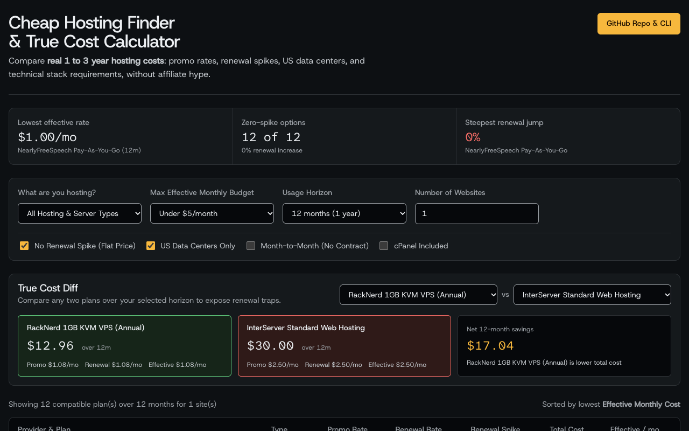

# Cheap Web Hosting Server — Real 1–3 Year Cost Comparison & Calculator

> **Find the cheapest compatible web hosting or VPS server without renewal surprises.**

Most "Best Cheap Web Hosting" lists rank providers by **advertised first-year promo prices** (`$1/mo`, `$2.95/mo`) while hiding what happens when the bill renews at `$11.99–$17.99/mo`.

This open-source repository compares **shared web hosting**, **cheap Linux VPS servers**, **WordPress hosting**, and **developer PaaS** based on **true 1–3 year Total Cost of Ownership (TCO)**, technical compatibility, US server locations, and month-to-month flexibility.

- **Interactive Web Finder & Calculator:** [`https://free-website-domains.github.io/cheap-web-hosting-server/`](https://free-website-domains.github.io/cheap-web-hosting-server/)
- **Structured Dataset:** [`data/providers.json`](data/providers.json) · [`data/plans.json`](data/plans.json) · [`data/pricing-history.json`](data/pricing-history.json)
- **Python CLI & Calculator:** [`hosting_finder.py`](hosting_finder.py) · [`src/hosting_finder/calculator.py`](src/hosting_finder/calculator.py)



---

## Cheapest Plans That Don't Spike on Renewal (`$1–$5/mo` Flat Pricing)

| Plan | Type | Monthly Rate | Renewal Spike | 1-Year Total | 3-Year Total | Lock-in |
| --- | --- | --- | --- | --- | --- | --- |
| **NearlyFreeSpeech Pay-As-You-Go** | Shared / PHP / Python | **`$1.00/mo`** | `0.0%` | `$12.00` | `$36.00` | None (1 mo) |
| **RackNerd 1GB KVM** | Linux VPS | **`$1.08/mo`** | `0.0%` | `$12.96` | `$38.88` | 12 mo |
| **IONOS VPS Linux XS** | Linux VPS | **`$2.00/mo`** | `0.0%` | `$24.00` | `$72.00` | None (1 mo) |
| **BuyVM KVM Slice 512MB** | Linux VPS | **`$2.00/mo`** | `0.0%` | `$24.00` | `$72.00` | None (1 mo) |
| **InterServer Standard** | Shared (Unlimited) | **`$2.50/mo`** | `0.0%` | `$30.00` | `$90.00` | None (1 mo) |
| **Hetzner Cloud CX22 (US)** | Linux VPS (4 GB RAM) | **`$4.99/mo`** | `0.0%` | `$59.88` | `$179.64` | None (1 mo) |

### Watch Out for "$1–$3/mo" Promo Traps

| Plan | Advertised Promo | Promo Term | Renewal Rate | Renewal Spike | 36-Mo Effective |
| --- | --- | --- | --- | --- | --- |
| **IONOS Web Hosting Plus** | `$1.00/mo` | 12 mo | `$14.00/mo` | `+1300.0%` | **`$9.67/mo`** (`$348.00`) |
| **Bluehost Basic** | `$2.95/mo` | 12 mo | `$11.99/mo` | `+306.4%` | **`$8.98/mo`** (`$323.16`) |
| **SiteGround StartUp** | `$2.99/mo` | 12 mo | `$17.99/mo` | `+501.7%` | **`$12.99/mo`** (`$467.64`) |

---

## Choose by What You Actually Need

The phrase *"cheap web hosting server"* covers two very different user jobs:
1. **Shared Web Hosting** — You want cPanel/hPanel, PHP, MySQL, WordPress, and email without managing a Linux server.
2. **VPS / Cloud Server** — You want root SSH access, dedicated RAM/vCPU, Docker/Node.js/Python, and predictable monthly billing.

| Goal / Intent | Guide |
| --- | --- |
| Shared hosting with lowest 3-year cost | [Cheap Web Hosting (Shared)](cheap-web-hosting/README.md) |
| Linux VPS with root access & Docker | [Cheap VPS Hosting](cheap-vps-hosting/README.md) |
| Plans genuinely under `$5/mo` effective | [Web Hosting Under $5/Month](under-5-dollars/README.md) |
| Plans under `$10/mo` over 3 years | [Web Hosting Under $10/Month](under-10-dollars/README.md) |
| WordPress with SSL, backups & PHP | [Cheap WordPress Hosting](wordpress-hosting/README.md) |
| PHP & MySQL stack | [Cheap PHP & MySQL Hosting](php-mysql-hosting/README.md) |
| Hosting 5, 10, or 20+ websites | [Cheap Hosting for Multiple Websites](multiple-websites/README.md) |
| Month-to-month without multi-year lock-in | [No-Contract Monthly Hosting](monthly-hosting/README.md) |
| Understand renewal pricing math | [Renewal Cost Calculator Methodology](renewal-cost-calculator/README.md) |

### Provider Deep-Dives & Head-to-Head Comparisons
- **Providers:** [Hostinger](providers/hostinger/README.md) · [IONOS](providers/ionos/README.md) · [Namecheap](providers/namecheap/README.md) · [Hetzner US VPS](providers/hetzner/README.md)
- **All Comparisons Index:** [Head-to-Head Hosting & VPS Comparisons](comparisons/README.md)
- **Hetzner vs Everyone (VPS & Cloud):**
  - [Hetzner vs DigitalOcean](comparisons/hetzner-vs-digitalocean/README.md) · [Hetzner vs Vultr](comparisons/hetzner-vs-vultr/README.md) · [Hetzner vs Akamai (Linode)](comparisons/hetzner-vs-linode/README.md) · [Hetzner vs OVHcloud](comparisons/hetzner-vs-ovhcloud/README.md) · [Hetzner vs Hostinger](comparisons/hetzner-vs-hostinger/README.md) · [Hetzner vs IONOS](comparisons/hetzner-vs-ionos/README.md) · [Hetzner vs RackNerd](comparisons/hetzner-vs-racknerd/README.md)
- **Shared & WordPress Comparisons:**
  - [Hostinger vs Namecheap](comparisons/hostinger-vs-namecheap/README.md) · [Hostinger vs Bluehost](comparisons/hostinger-vs-bluehost/README.md) · [Hostinger vs SiteGround](comparisons/hostinger-vs-siteground/README.md) · [InterServer vs Hostinger](comparisons/interserver-vs-hostinger/README.md) · [Namecheap vs Bluehost](comparisons/namecheap-vs-bluehost/README.md) · [IONOS vs Namecheap](comparisons/ionos-vs-namecheap/README.md) · [Shared vs VPS](comparisons/shared-vs-vps/README.md)

---

## Quick Start: Python CLI

Zero external dependencies (Python 3.9+ standard library only).

```bash
# Find all US-based hosting under $5/mo effective over 36 months
python3 hosting_finder.py --months 36 --max-budget 5 --us-only

# Find a cheap Linux VPS with Docker and root access
python3 hosting_finder.py --category vps --stack docker root_access --us-only

# Find month-to-month hosting for 10 websites (no multi-year contract)
python3 hosting_finder.py --websites 10 --monthly-only --months 24

# Compare specific plans side-by-side over 36 months
python3 hosting_finder.py --compare ionos-plus hostinger-premium namecheap-stellar-plus hetzner-cx22-us --months 36
```

### Run Tests

```bash
python3 -m unittest discover -s tests -v
```

---

## Data & Methodology

- All plans are stored in [`data/plans.json`](data/plans.json) with `source_url` and `last_verified` timestamps.
- Effective monthly cost is calculated as:
  $$\text{Effective Monthly} = \frac{(\text{Promo Months} \times \text{Promo Rate}) + (\text{Renewal Months} \times \text{Renewal Rate}) + \text{Setup Fee}}{\text{Total Months}}$$
- Multi-site scaling automatically accounts for single-site plan limits (`max_websites`).
- Taxes, optional add-on backups, and domain renewal fees after year 1 are excluded from base plan calculations and noted separately where applicable.

## License

MIT — see [LICENSE](LICENSE).
